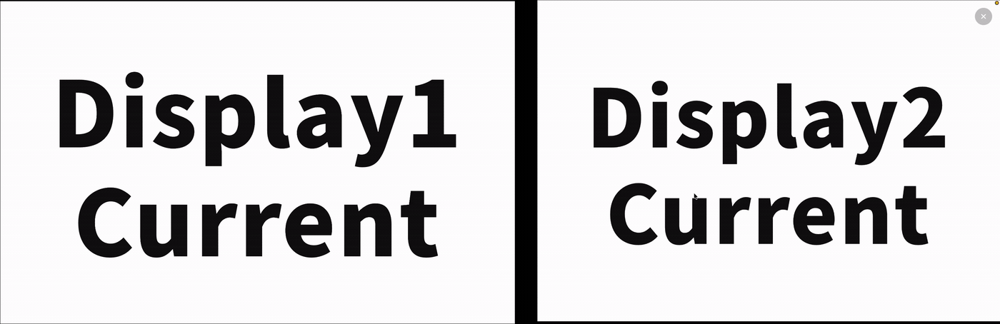

# ONIWA

**Find and switch macOS Spaces by name, without leaving the keyboard.**

ONIWA is a free, open-source menu-bar app that makes Apple's **native Mission Control Spaces** searchable. Name your desktops, add search tags, and switch a named pair of Spaces across two displays. ONIWA does not create its own virtual desktop system.

**Latest published release:** [ONIWA v0.1.0](https://github.com/hiro259/oniwa/releases/tag/v0.1.0) — Developer ID-signed and Apple-notarized. This branch prepares **v0.1.1**, which adds guided permission setup for first-time users. Core search, single-Space switching, two-display sets and Sidecar were tested on a real Apple silicon Mac; other hardware and macOS versions remain less tested.

## Demo

**Switch a two-display Space set with one action:**



## Features

- **Named Spaces:** assign your own names and search tags to regular desktops and fullscreen app Spaces.
- **Fuzzy search:** find Spaces by names, manual tags and detected app names. Add short aliases such as `dev` or `shumi` for faster lookup.
- **Keyboard-first navigation:** open the palette with a shortcut, select with `↑/↓`, and press `Enter` to switch.
- **Two-display sets:** save one Space from each of two displays under a shared name and switch to the pair with a single command.
- **Pinning and sorting:** pin frequently used results and choose the list order.
- **Choose the palette display:** keep the search palette on the built-in Mac screen or a selected external monitor/Sidecar display, independent of mouse position. If that display disconnects, the palette temporarily falls back to the Mac/primary screen; the selection is retained for reconnection.
- **Native macOS appearance:** a compact translucent palette with adjustable background transparency, light/dark adaptation, and Japanese/English UI (system language or manual selection).

Names, tags and sets are saved **locally** on your Mac. No online account is needed.

## Requirements

- **macOS 13 or later**.
- For the official download, get [the notarized v0.1.0 ZIP](https://github.com/hiro259/oniwa/releases/tag/v0.1.0) and move ONIWA.app to Applications. **Xcode or Apple Command Line Tools are only needed to build from source.**
- macOS Mission Control shortcuts **Move left a space / Move right a space** (`Control+←` / `Control+→`) enabled in **System Settings → Keyboard → Keyboard Shortcuts → Mission Control**.
- **Accessibility / key-event posting permission** for ONIWA when macOS prompts for it. See [Permissions and troubleshooting](#permissions-and-troubleshooting).

## Build and run from source

To build ONIWA locally from source instead of installing the signed release:

```sh
git clone https://github.com/hiro259/oniwa.git
cd oniwa
swift test
sh build.sh
open build/ONIWA.app
```

The app runs in the **menu bar**, with a four-stone icon. There is no separate main window.

The current `build.sh` uses **ad-hoc code signing** by default. macOS may request Accessibility approval again after a rebuild. For a persistent development signing identity and icon checks, see [Development notes](docs/DEVELOPMENT.md). Do not treat these local builds as notarized distribution packages.

## Quick start

1. **Open ONIWA:** press `⌥ Option + Space` (the default for a new installation), or choose **Search Spaces… / Spaceを検索…** from the ONIWA menu-bar icon. The shortcut can be changed in **Shortcuts / ショートカット**.
2. **Find a Space:** type a name, tag or app name; use `↑/↓` to select, `Enter` to switch, and `Esc` to close.
3. **Name a Space:** click its pencil icon, enter a display name, then press `⌘S` or click **Save / 保存**. For manual search tags, enter each tag and press `Enter` to add it before saving.
4. **Make a two-display set:** click **Add set / セットを追加**, select a Space on each of two different displays, name the set, and save. The set appears alongside single Spaces in search results.
5. **Choose where search appears:** from the menu-bar icon, open **Search palette display / 検索パレットの表示先** and select the built-in or a connected external screen.
6. **Adjust the appearance:** use **Background Transparency / 背景の透明度** and **Language / 言語** in the menu.

### Keyboard shortcuts

| Shortcut | Action |
| --- | --- |
| `⌥ Space` (default; configurable) | Open or close ONIWA |
| `↑` / `↓` | Choose a search result |
| `Enter` | Switch to the selected Space or two-display set |
| `Esc` | Close the palette or cancel an editor |
| `Enter` in a search-tag field | Add or confirm the tag |
| `⌘S` in an editor | Save a Space name/tags or a two-display set |

Existing installations preserve their previously chosen launch shortcut. If `⌥ Space` conflicts with the system or another app, select a different shortcut from ONIWA's menu.

## Permissions and troubleshooting

ONIWA uses macOS's ordinary Space movement shortcuts to perform switching. It needs both working **`Control+←/→` Mission Control shortcuts** and authorization to post keyboard events.

- **First launch (v0.1.1 and later):** ONIWA checks Accessibility permission and the ability to post keyboard events, but shows only **Accessibility** as a permission to configure. The setup window offers **Open System Settings** and **Recheck** and shows the running app path. **Keyboard event posting: OK** appears only after a successful Space transition; it is not a second permission you must grant. Open the same guide from **Permissions and setup…** in the menu bar.
- **Install location:** moving ONIWA into **Applications** is recommended, but not required. The planned **v0.1.1 DMG** will show ONIWA and an Applications shortcut side by side: drag ONIWA onto Applications, then launch the installed copy. When ONIWA runs elsewhere, the setup window offers **Show this app in Finder** and **Open Applications**. Quit it before moving; reauthorize Accessibility if macOS still references the old path.
- **A switch is blocked by permissions:** open **System Settings → Privacy & Security → Accessibility**, enable the *specific* `ONIWA.app` you are running, then restart the app if permission remains denied.
- **The accessibility toggle is enabled but switching still fails:** check for an older `build/ONIWA.app` or `dist/ONIWA.app` entry in Accessibility settings. Remove the stale entry, add the actual installed copy (usually `/Applications/ONIWA.app`), and restart it. The app's permission guide shows its current path. If necessary, see [the app-specific TCC reset procedure](docs/RELEASING.md#permission-troubleshooting-development-vs-distribution-copies).
- **The palette opens but Spaces do not change:** test physical `Control+←` / `Control+→` and confirm those shortcuts are enabled under Mission Control.
- **A switch goes to an unexpected Space:** use **Diagnostics / 診断 → Open switching log… / 切り替え診断ログを開く…**. Logs are stored at `~/Library/Logs/ONIWA/switch.log`. **Review or redact names and application information before sharing a log.**

See [Development notes](docs/DEVELOPMENT.md) for deeper diagnostics, signing details and manual regression checks.

## Known limitations

- **Native Spaces only.** ONIWA does not move app windows, rename Spaces inside macOS Mission Control, or provide a free-placement desktop map.
- **Fullscreen Space identity may change.** macOS can recreate a Space when a fullscreen window is closed or reconfigured. ONIWA intentionally does not copy an old name onto an unrecognized new Space. You may need to name the new Space again.
- **A missing paired display is not guessed.** When an external screen disconnects, a two-display set requiring that screen becomes unavailable rather than switching to a different Space. After sleep, macOS may require you to reconnect Sidecar as an extended display; ONIWA can use the saved set again once its original Space identities are visible.
- **Display targeting can move the mouse pointer** during a Space switch. Fixing the search palette on a particular screen does not change the display targeted by a Space-set command.
- **macOS compatibility is not guaranteed across updates.** Space discovery relies on private, read-only SkyLight APIs; ONIWA does not disable SIP or write private Space data. New OS versions may change how Spaces are enumerated or how shortcut events are delivered.
- **No login-at-startup feature is included in this release plan.** ONIWA is started manually.

## Development and release

- [Implementation details, diagnostics and historical research](docs/DEVELOPMENT.md)
- [Developer ID signing, notarization and v0.1 release steps](docs/RELEASING.md)
- [v0.1 release-preparation tracker](https://github.com/hiro259/oniwa/issues/6)
- [Third-party licenses and notices](THIRD_PARTY_NOTICES.md)

**License:** MIT. See [LICENSE](LICENSE).
